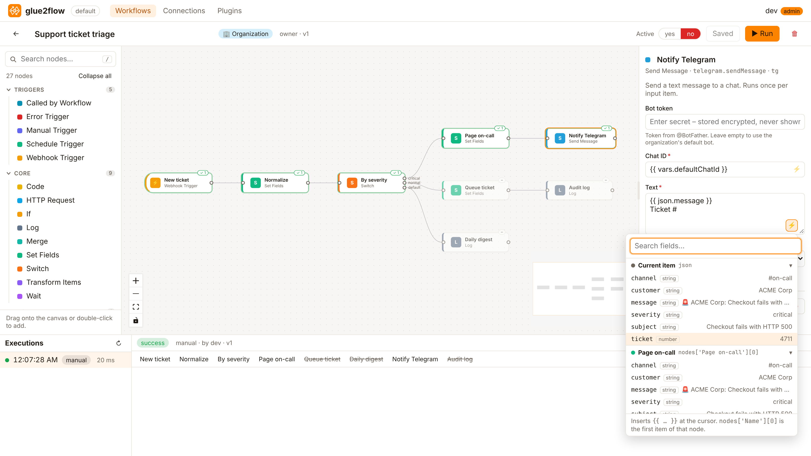

<p align="center">
  
</p>

<h1 align="center">glue2flow</h1>

<p align="center">
  <b>Self-hosted workflow automation for teams.</b><br>
  Draw your processes as boxes and arrows, connect your tools, and let them run on your own servers.
</p>

<p align="center">
  <a href="https://github.com/glue2flow/g2f/releases/latest">Latest release</a> ·
  <a href="docs/getting-started.md">Get started</a> ·
  <a href="docs/README.md">Documentation</a> ·
  <a href="docs/plugins.md">Plugins</a> ·
  <a href="#status">Status</a> ·
  <a href="#roadmap">Roadmap</a>
</p>

<p align="center">
  <a href="https://github.com/glue2flow/g2f/actions/workflows/ci.yml"></a>
  <a href="https://github.com/glue2flow/g2f/releases/latest"></a>
  <a href="LICENSE"></a>
</p>



---

**glue2flow** (short: **g2f**) is an open-source (MIT) workflow automation tool in the spirit of
n8n and Power Automate. Webhooks, schedules, APIs, approvals and AI models become one flow
that your whole organization can share, with sign-in through your existing Keycloak.

## Why glue2flow

🧩 **Visual editor.** Drag nodes, connect them, press ▶ Run. Every run shows each node's
output, so you see what happened at a glance.

⚡ **Dynamic content.** Click ⚡ in any field to pick a value from an earlier node, with
sample data from the last run. No need to memorize paths.

🏢 **Built for organizations.** Keep workflows private, share them with Keycloak groups, or
publish them to the whole organization. Roles from *viewer* to *owner*.

🔐 **Secrets stay secret.** Tokens are encrypted at rest and never returned by the API.
Plugins get them; workflow fields don't.

🔌 **Extend it in any language.** Wrap a REST API in a few lines of YAML, or write a
sandboxed WebAssembly plugin in Go, JavaScript or Rust, and import it at runtime. Native Go
modules cover protocols like SMTP and IMAP.

🪶 **Small and simple to run.** One Go binary (~25 MB image) plus PostgreSQL. Add
replicas when you need them: if one stops, another continues its runs where they left off.

## What's in the box

| | |
| --- | --- |
| **Triggers** | Manual · Schedule (cron, once, timezones) · Webhook (token / HMAC) · Form (text and multiple-choice questions; open, captcha, Keycloak login or e-mail code) · Called by Workflow · Error Trigger · Polling: Email Received (IMAP), Gmail and Outlook New Email |
| **Logic & flow** | Condition (if / else) · Switch · Merge (append, join, pair) · And / Or / Xor · Execute Workflow (loops, batches) |
| **Data** | HTTP Request · Set Fields · Filter · Sort · Limit · Split Out · Aggregate · Map · Rename / Remove Fields · Date & Time · CSV · Transform Items · Code (JavaScript, isolated with a memory limit) · Log |
| **Memory** | Remove Duplicates (within a run or across runs) · Data Store (values, counters between runs) |
| **Long-running** | Wait for a time, a date, or an approval link, for days if needed, surviving restarts |
| **Integrations** | Gmail · Outlook · Microsoft Teams · Google Sheets (OAuth2) · Email (SMTP/IMAP) · GitHub · Slack · Telegram · Mistral AI |
| **Accounts** | Users connect their own OAuth2 accounts and share them with groups |

## Try it in one minute

```bash
git clone https://github.com/glue2flow/g2f && cd g2f
docker compose up --build
```

Open http://localhost:8080 and sign in as `alice` / `alice`. More demo users and local
development without Docker: **[Getting started](docs/getting-started.md)**.

## Status

glue2flow is **in active development** and not yet 1.0. It works end to end, but expect
breaking changes to APIs and manifests before a stable release. The `docker-compose.yml`
setup is a demo with default passwords.

| Area | State |
| --- | --- |
| Visual editor, executions view, run log | ✅ Working |
| Triggers: manual, schedule, webhook, sub-workflow, error | ✅ Working |
| Core nodes, logic gates, sub-workflows and loops | ✅ Working |
| Wait / human approval (persistent, replica-safe) | ✅ Working |
| ⚡ Dynamic content with output schemas | ✅ New |
| Keycloak / OIDC sign-in, sharing by groups and organizations | ✅ Working |
| Encrypted secrets, plugin config and vars, key rotation | ✅ Working |
| Plugins: YAML/HTTP and WebAssembly, runtime import | ✅ Working |
| Connected OAuth2 accounts | ✅ Working (Gmail, Google Sheets, Outlook, Teams included) |
| Email over SMTP/IMAP (native Go module) | ✅ New |
| Polling triggers, Remove Duplicates, Data Store | ✅ New |
| Data nodes: Filter, Sort, Split Out, Aggregate, Date & Time, CSV, … | ✅ New |
| Code node in an isolated process with a memory limit | ✅ New |
| Several replicas: executions survive restarts, crashes and rolling deploys | ✅ New |
| Workflow history, import/export | 🗺️ Planned |

## Roadmap

- Reusable API-key credentials (like connections, for non-OAuth services)
- Plugin signing and a plugin catalog
- More OAuth2 integration packs (HubSpot, Salesforce, Google Calendar/Drive, SharePoint)
- Push instead of polling for mail (IMAP IDLE, Gmail push notifications, Graph subscriptions)
- XML / HTML parsing, file (binary) data between nodes
- More native protocol modules: Postgres/MySQL, SFTP
- Cancelling running executions from the editor (waiting ones can be cancelled today)
- Webhook rate limiting and a "test URL" that works while a workflow is inactive
- Workflow version history and import/export
- SSRF protection for HTTP nodes (block private networks by default)

## Documentation

| | |
| --- | --- |
| **Use it** | [Getting started](docs/getting-started.md) · [Nodes](docs/nodes.md) · [Triggers](docs/triggers.md) · [Expressions & ⚡](docs/expressions.md) · [Sharing](docs/sharing.md) · [Connected accounts](docs/connections.md) · [Email](docs/email.md) |
| **Run it** | [Configuration](docs/configuration.md) · [Secrets](docs/secrets.md) · [Architecture](docs/architecture.md) |
| **Extend it** | [Plugins](docs/plugins.md) · [HTTP modules](docs/http-modules.md) · [Telegram sample](examples/plugins/telegram) · [Mistral AI sample](examples/plugins/mistral) |

Full index: **[docs/](docs/README.md)**

## Built with

[Go](https://go.dev) · [PostgreSQL](https://www.postgresql.org) · [React](https://react.dev) +
[React Flow](https://reactflow.dev) · [expr](https://expr-lang.org) ·
[Extism](https://extism.org) + [wazero](https://wazero.io) · [goja](https://github.com/dop251/goja) ·
[Keycloak](https://www.keycloak.org)

## License

glue2flow is released under the [MIT License](LICENSE).
